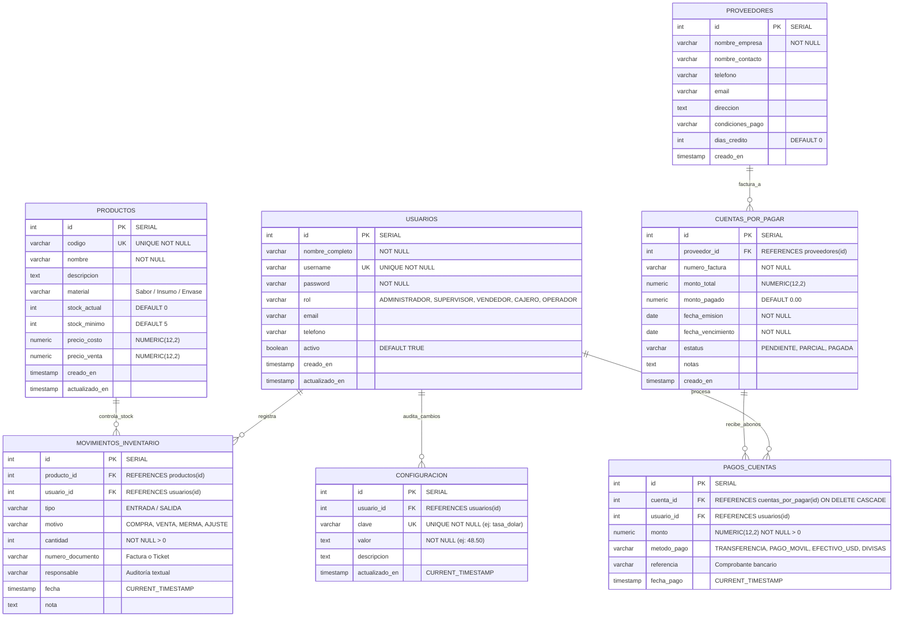

# SISTEMA DE GERENCIA Y PLANIFICACIÓN PARA LA OPTIMIZACIÓN DE PROCESOS ADMINISTRATIVOS
## COMERCIAL CAMADU C.A.

**Trabajo Especial de Grado para optar al Título de Ingeniero en Informática**  
* **Institución:** Universidad Alejandro de Humboldt (UAH) - Facultad de Ingeniería  
* **Autora:** Herlin Korina Aquino  
* **Tutora:** MSc. Ofelia Sánchez  
* **Ubicación:** Caracas, Venezuela (2026)  

---

## 1. MODELO ENTIDAD-RELACIÓN (DER)

El sistema de base de datos relacional está implementado en **PostgreSQL 18** (`camadu_db`). Se encuentra **100% normalizado**, sin "tablas isla", garantizando la integridad referencial, trazabilidad de operaciones y auditoría por usuario.

### 1.1 Diagrama Entidad-Relación (Mermaid)

---

### 1.2 Diccionario de Datos y Relaciones (Claves Foráneas)

| Tabla Origen | Clave Foránea (FK) | Tabla Destino (PK) | Cardinalidad | Propósito Funcional en el Negocio |
| :--- | :--- | :--- | :---: | :--- |
| `movimientos_inventario` | `producto_id` | `productos(id)` | **N : 1** | Identifica el producto o insumo al que se le suma o descuenta existencia física. |
| `movimientos_inventario` | `usuario_id` | `usuarios(id)` | **N : 1** | Identifica al empleado, operador de caja o supervisor que registró la venta, entrada o merma. |
| `cuentas_por_pagar` | `proveedor_id` | `proveedores(id)` | **N : 1** | Enlaza la factura de compra a crédito con el proveedor correspondiente. |
| `pagos_cuentas` | `cuenta_id` | `cuentas_por_pagar(id)` | **N : 1** | Asocia el abono financiero a la factura adeudada (actualizando el saldo deudor de forma atómica). |
| `pagos_cuentas` | `usuario_id` | `usuarios(id)` | **N : 1** | Audita qué usuario autorizó o procesó el pago al proveedor. |
| `configuracion` | `usuario_id` | `usuarios(id)` | **N : 1** | Registra qué usuario administrador realizó la actualización de la tasa oficial del día (BCV). |

---

## 2. DELIMITACIONES TÉCNICAS Y TECNOLÓGICAS DEL PROYECTO

### 2.1 Texto Académico para el Capítulo I (Tesis UAH)

> **Delimitación Tecnológica y Técnica:**  
> El desarrollo del *Sistema de Gerencia y Planificación para la Optimización de Procesos Administrativos en la empresa Comercial Camadu C.A.* se fundamenta en una arquitectura de software basada en el desacoplamiento cliente-servidor mediante servicios web **RESTful**. Para la capa del servidor (*Backend*), se seleccionó el entorno de ejecución asíncrono **Node.js** complementado con el framework **Express.js**, garantizando un procesamiento no bloqueante impulsado por eventos (*Event Loop*) para la gestión transaccional de operaciones. Como Sistema Gestor de Bases de Datos Relacionales (SGBDR), se empleó **PostgreSQL versión 18**, aplicando integridad referencial estricta, índices de optimización y transacciones bajo el estándar **ACID** (`BEGIN`, `COMMIT`, `ROLLBACK`) con bloqueo de registros por concurrencia (`SELECT FOR UPDATE`).  
> 
> En la capa de cliente (*Frontend*), se estructuró una aplicación de página única (**SPA - Single Page Application**) desarrollada bajo estándares web nativos empleando **HTML5 semántico**, **CSS3** parametrizado con tokens de diseño adaptados a la identidad corporativa de la empresa, y **JavaScript moderno (ES6+)** para la reactividad de la interfaz y el consumo asíncrono de la API mediante la interfaz `Fetch`. Asimismo, el sistema incorpora un modelo de conversión bimonetaria dinámico (**USD / VES**) gobernado por la tasa oficial del Banco Central de Venezuela (BCV) parametrizable en base de datos, y un módulo de control de acceso basado en roles (**RBAC**).

---

### 2.2 Desglose del Stack Tecnológico

1. **Backend & API REST:**
   * **Entorno de Ejecución:** Node.js v26.
   * **Framework HTTP:** Express.js v5.3.
   * **Conexión a BD:** Driver nativo `pg` (Pool de conexiones).
   * **Seguridad Transaccional:** Consultas 100% parametrizadas (`$1, $2, ...`) que erradican la Inyección SQL (SQLi).
   * **Control de Concurrencia:** Bloqueo a nivel de fila (`FOR UPDATE`) en transacciones de almacén para evitar ventas sin stock en accesos simultáneos.

2. **Base de Datos (SGBD):**
   * **Motor:** PostgreSQL 18.1 (`camadu_db`).
   * **Tipos de Datos:** Claves numéricas autoincrementales (`SERIAL`), tipos de precisión monetaria fija (`NUMERIC(12,2)` para costos y precios), marcas de tiempo automáticas (`TIMESTAMP`).
   * **Restricciones de Dominio:** Restricciones `CHECK` para tipos de movimiento (`ENTRADA`, `SALIDA`) y estados de cuenta (`PENDIENTE`, `PARCIAL`, `PAGADA`).
   * **Índices de Optimización:** Índices B-Tree en `productos(codigo)`, `movimientos_inventario(fecha, tipo)`, `cuentas_por_pagar(fecha_vencimiento, estatus)` y `usuarios(username)`.

3. **Frontend (Interfaz de Usuario):**
   * **Arquitectura:** Single Page Application (SPA) nativa con enrutamiento dinámico en memoria.
   * **Paleta de Colores Corporativa:** Inspirada en la identidad visual de *Comercial Camadu C.A.*:
     * Rojo Fresa / Carmesí Camadu: `#d81159` / `#c8102e`
     * Turquesa / Glaciar: `#00b4d8`
     * Amarillo Crema: `#ffc72c`
     * Rosa Chicle: `#f72585`
     * Barra Lateral Rosada Ejecutiva: Gradiente corporativo `#db2777` - `#be185d` - `#9d174d`
   * **Soporte Bimonetario:** Conversión en tiempo real de precios a Bolívares (`Bs.`) calculada según la tasa activa.

---

### 2.3 Matriz de Alcance Técnico (Fronteras del Sistema)

| Módulo / Funcionalidad | Alcance Implementado (Dentro del Prototipo) | Límite Técnico (Fuera de Alcance / Futuro) |
| :--- | :--- | :--- |
| **Inventario & Stock** | Catálogo con alertas visuales de stock mínimo, búsqueda en tiempo real y costos/precios en USD y Bs. | No incluye lectura de códigos de barras por radiofrecuencia (RFID). |
| **Movimientos de Almacén** | Registro transaccional de compras, ventas, mermas y ajustes con validación atómica de existencias. | No genera órdenes de despacho automáticas con empresas de logística externa. |
| **Cuentas por Pagar (CxP)** | Registro de facturas comerciales, seguimiento de vencimientos y abonos parciales/totales. | No realiza transferencias bancarias automatizadas con consorcios bancarios. |
| **Inteligencia y Rotación** | Ranking mensual con medallas (🥇🥈🥉), porcentaje de participación y categorización de demanda (Alta, Media, Baja). | No incluye algoritmos de pronóstico predictivo con Machine Learning. |
| **Gestión de Usuarios & RBAC** | CRUD de usuarios y control de acceso basado en roles (**ADMINISTRADOR, SUPERVISOR, VENDEDOR, CAJERO**), con restricción estricta de acceso al módulo de proveedores para roles de ventas y caja. | No integra autenticación federada externa (OAuth2 / Google Sign-In). |
| **Facturación Fiscal** | Emisión de comprobantes y notas de venta operativas para control interno de almacén. | No se conecta directamente con impresoras fiscales homologadas por el SENIAT. |

---

### 2.4 Matriz de Control de Acceso por Roles (RBAC)

| Módulo del Sistema | ADMINISTRADOR | SUPERVISOR | VENDEDOR | CAJERO | Justificación Administrativa y de Seguridad |
| :--- | :---: | :---: | :---: | :---: | :--- |
| **Dashboard General** | ✅ Sí | ✅ Sí | ✅ Sí | ✅ Sí | Visibilidad global de indicadores y estado de stock para la toma de decisiones. |
| **M1: Control de Inventario** | ✅ Sí | ✅ Sí | ✅ Sí | ✅ Sí | Consulta de catálogo y verificación de existencias para la venta o reposición. |
| **M2: Entradas y Salidas** | ✅ Sí | ✅ Sí | ✅ Sí | ✅ Sí | Registro de ventas al mostrador y movimientos de mercancía por operador. |
| **M3: Cuentas por Pagar** | ✅ Sí | ✅ Sí | ❌ No | ❌ No | Información financiera confidencial restringida a gerencia y supervisión. |
| **M4: Más Vendidos (Reportes)**| ✅ Sí | ✅ Sí | ✅ Sí | ✅ Sí | Consulta de rotación para orientación de metas comerciales. |
| **M5: Directorio Proveedores** | ✅ Sí | ✅ Sí | 🚫 **SIN ACCESO** | 🚫 **SIN ACCESO** | **Restricción de Negocio:** Protege contactos directos, costos de compra y condiciones crediticias. |
| **M6: Gestión de Usuarios** | ✅ Sí | ❌ No | ❌ No | ❌ No | Exclusivo del Administrador para la creación y revocación de accesos al sistema. |
| **Modificar Tasa BCV** | ✅ Sí | ✅ Sí | ❌ No | ❌ No | Protege el factor cambiario oficial contra manipulaciones no autorizadas. |

---

### 2.4 Requerimientos Mínimos de Infraestructura

* **Servidor Local / Estación de Trabajo:**
  * Procesador: Dual-Core de 2.0 GHz o superior (Intel Core i3 / AMD Ryzen 3 en adelante).
  * Memoria RAM: Mínimo 4 GB (Recomendado 8 GB).
  * Almacenamiento: 500 MB libres en disco (SSD preferible).
  * Sistema Operativo: Windows 10/11 (64 bits) o Linux Ubuntu/Debian.
* **Cliente / Estación Operador:**
  * Cualquier navegador web moderno con soporte ECMAScript 6+ (Google Chrome, Microsoft Edge, Mozilla Firefox).
  * Resolución de pantalla recomendada: 1280x720 o superior.

